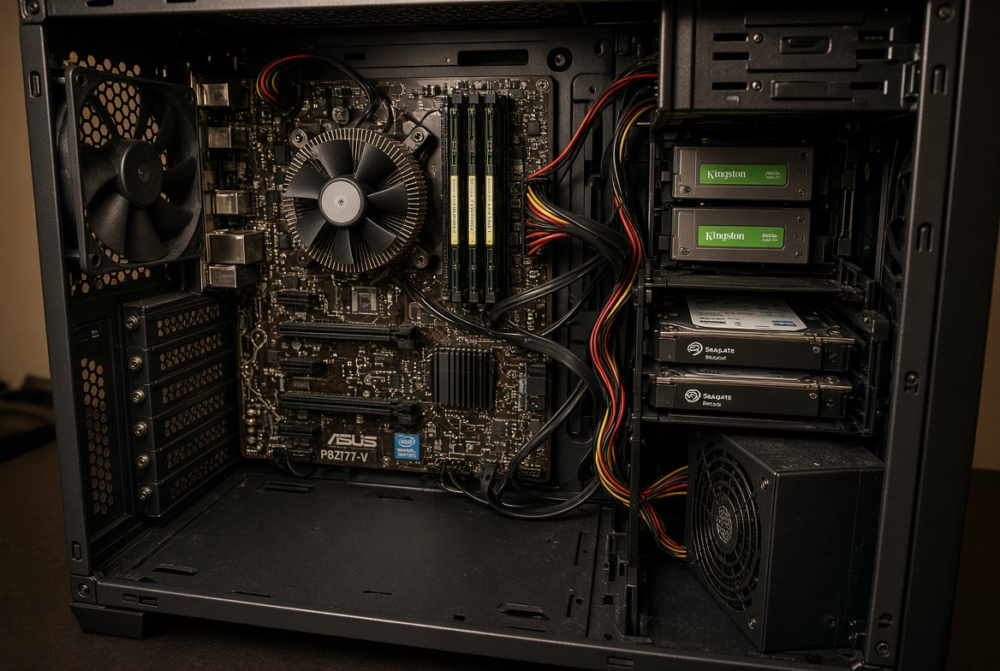
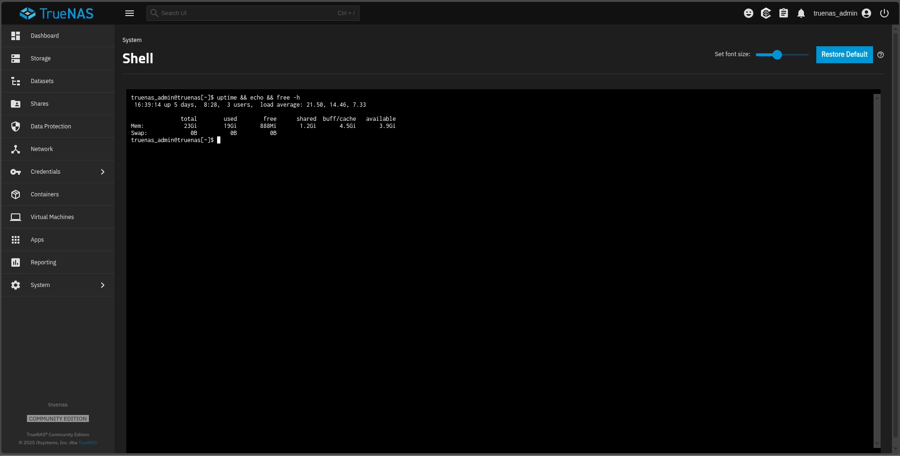

# Mi homelab corre con 24 GB de DDR3 y la RAM nunca fue el problema

Un kit de 32 GB de DDR5 costaba unos 70 euros hace un año. Hoy, el mismo kit, cuesta 500. No es una oferta puntual ni una tienda aprovechada: es el precio de mercado, y viene de que la DRAM que antes iba a nuestras computadoras ahora se va a memoria HBM para centros de datos de inteligencia artificial. La memoria de consumo es lo último que se fabrica, con lo que sobra.

Mientras tanto, mi servidor de casa —el que sostiene mi trabajo, mis backups y las aplicaciones que uso todos los días— corre con 24 GB de DDR3 en una placa de 2012 y un procesador de 2011.

Este post no es una apología del hardware viejo. Es la cuenta que hice antes de comprar memoria, y por qué la respuesta no fue la que esperaba.

## El servidor

Lo armé con lo que había. Es literalmente eso: piezas que sobraban de otros equipos y dos discos que compré usados.

- **Procesador:** Intel Core i3-2100, de 2011. Dos núcleos, cuatro hilos, 3.1 GHz.
- **Placa:** ASUS P8Z77-V LX, socket LGA1155. Cuatro ranuras DDR3, máximo 32 GB.
- **Memoria:** 24 GB DDR3 (el sistema ve 23 GiB).
- **Discos:** dos SSD Kingston de 240 GB y dos Seagate de 4 TB.
- **Sistema:** TrueNAS Scale, con las aplicaciones en contenedores.

Sobre eso corren treinta y dos servicios. n8n para las automatizaciones, Immich para las fotos, Nextcloud, Supabase, Jellyfin, AdGuard, el servidor de memoria(RAG), el proxy, los backups.

## La cuenta que importa

Cuando alguien pregunta por un homelab, la conversación siempre termina igual: "ponle 64 GB y vas sobrado". Como si la memoria fuera gratis. No lo es, y este año menos que nunca.

Precio por gigabyte, hoy:

- **DDR5 nueva:** un kit de 32 GB ronda los 500 dólares. Son unos **15.60 dólares por GB**.
- **DDR3 usada:** un módulo de 8 GB a 1600 MHz se consigue por **14 dólares**. Son **1.75 dólares por GB**.

La diferencia es de casi nueve veces. Nueve. Por la misma cantidad de memoria.

Y hay algo más incómodo: llenar las cuatro ranuras de mi placa —pasar de 24 a 32 GB— cuesta unos 56 dólares. Menos de lo que cuesta un solo módulo de 16 GB de DDR5, que hoy anda por los 250.

Ahí está el punto. No es que la DDR3 sea buena. Es que el precio de la DDR5 dejó de tener relación con lo que la memoria hace.

## Por qué 24 GB alcanzan

Aquí viene la parte que a mí me sorprendió cuando la medí.

Con los treinta y dos servicios arriba, el servidor usa **15 GB de los 23 disponibles**. Queda un 35% libre. Y no está haciendo nada raro: está sirviendo Nextcloud, transcodeando en Jellyfin, indexando fotos en Immich y corriendo workflows de n8n para clientes.

La memoria libre tampoco es memoria desperdiciada: el sistema la usa como caché de disco. Si mirás `free -h` vas a ver que "free" es bajo pero "available" es alto. Eso es normal y es sano.

Lo importante: **no hay swap**. Cero. Nunca llegué a un punto donde el sistema tuviera que sacar páginas a disco por falta de memoria.

## Dónde sí se queda corto

Acá es donde este post se vuelve útil y no una fantasía.

El cuello de botella de mi servidor **no es la memoria. Es el procesador.** Un i3 de dos núcleos de 2011 se queda corto cuando Immich indexa una biblioteca nueva, cuando Jellyfin transcodifica sin aceleración por hardware, o cuando tres workflows de n8n procesan al mismo tiempo.

Si tengo 56 dólares para gastar, no los pongo en llegar a 32 GB de RAM. Los pongo en un **i7-3770 usado**: mismo socket, cuatro núcleos y ocho hilos, y hoy se consigue por 25 dólares. Es la mejora más grande por el dinero más pequeño que existe en esta plataforma.

Esa es la trampa de la conversación sobre RAM: se compra memoria por reflejo cuando el problema está en otro lado. Si tu servidor hace swap, la RAM es el problema. Si tu procesador está al 100% y la memoria al 60%, comprar RAM no te va a salvar el día.

## Lo que no te dicen del hardware viejo

No todo es ganancia, y sería deshonesto venderlo así.

- **Sin ECC.** La memoria con corrección de errores es lo que querés en un servidor. Mi placa no la soporta. Es un riesgo real a largo plazo, sobre todo con ZFS.
- **Solo SATA.** Nada de NVMe. Los discos son lentos y los backups lo sienten.
- **Hardware de quince años.** Una placa que falla a esta altura no se reemplaza: se jubila. Tengo que asumir que cualquier día no arranca.
- **Consumo.** Es la parte que casi nadie calcula. Mi UPS marca unos 60 VA de carga, que vienen a ser unos 50 o 55 vatios. Eso son unos 39 kWh al mes. A la tarifa base de ENSA (B/. 0.17581 por kWh, primer semestre de 2026), son unos **B/. 6.85 al mes** antes del crédito del Fondo de Estabilización Tarifaria. Unos 82 dólares al año.

Barato de comprar no es lo mismo que gratis de correr. Un equipo moderno consumiría la mitad, pero costaría veinte veces más. La cuenta completa hay que hacerla con los dos números.

Y está el riesgo que sí me preocupa: **un solo equipo**. No tengo redundancia. Si esa placa muere, el servidor muere con ella.

## La regla que uso ahora

Después de darle vueltas, me quedé con una regla simple:

1. **Si hay swap, comprá RAM.** Es el único síntoma que justifica la compra sin discusión.
2. **Si la CPU está al 100%, comprá CPU.** La memoria no arregla un procesador saturado.
3. **Si no hay ninguno de los dos, no compres nada.** Y menos en 2026, con los precios donde están.

Y una cuarta, que es la que más me costó aceptar: **presupuestá el reemplazo, no solo la compra**. El hardware viejo no es una estrategia eterna; es una forma de ganar tiempo mientras ahorrás para el bueno.

## Cierre

No escribo esto para convencer a nadie de que arme su homelab con piezas de 2011. Escribo esto porque pasé semanas mirando precios de memoria, convencido de que mi servidor estaba corto, y la medición me dijo otra cosa.

El servidor no estaba corto de RAM. Estaba corto de núcleos.

Antes de comprar memoria este año, abrí una terminal y mirá dos números: cuánta memoria tienes disponible de verdad, y cuánto está trabajando tu procesador. La respuesta suele estar en el segundo.
